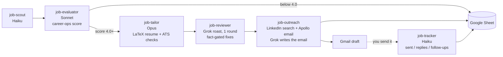

# Job-search kit: career-ops + Claude agents + Grok + Apollo + Gmail

An internship or job search that mostly runs itself. Every morning it:
1. finds new postings;
2. scores each one against your CV with [career-ops](https://github.com/career-ops-hq/career-ops);
3. for every strong match:
   - tailors your LaTeX resume;
   - has **Grok** roast it like a blunt recruiter;
   - finds a recruiter or hiring manager (web search, plus **Apollo** for the email);
   - writes a short cold email and saves it as a **Gmail draft**.

Everything lands in one **Google Sheet**. Through the day it watches Gmail, so the sheet knows when you sent an email and when someone replied.

**You stay in charge of everything that leaves your hands.** It never submits an application, never sends an email (drafts only), and never answers work-authorization questions for you. Apollo credits are only spent within a small budget you set.

## How it works



A "lead" Claude session (a scheduled task, or you running `/job-pipeline <url>`) hands each stage to a small expert agent, and only the lead writes shared files. The rules all live in one file, `career-ops/modes/_custom.md`, which every agent reads.

| Stage | Who | What it does |
|---|---|---|
| Scout | `job-scout` | Reads SimplifyJobs, speedyapply, YC job pages, career-ops' portal scanner, and optionally Runway and YC Work at a Startup. Drops obvious misses. |
| Evaluate | `job-evaluator` | Pulls the job description (Greenhouse/Ashby/Workday APIs when it can), checks hard stops (citizenship, clearance, ITAR), scores it with career-ops, writes a report, and fills the job's sheet row (79 columns). |
| Tailor | `job-tailor` | Copies your master `.tex`, reorders and rewords bullets to mirror the job (facts never change), and keeps it to one page. Then it runs an ATS keyword match and an ATS parse check, and files the PDF. |
| Review | `job-reviewer` + Grok | Grok reviews the **redacted** resume as a recruiter for that exact role. Claude applies a fix only if it's still true to your CV, keeps one page, and doesn't lower the ATS score. Gemini is an optional fallback. |
| Outreach | `job-outreach` + Grok + Apollo | Finds a recruiter and a hiring-side contact via LinkedIn search. Gets the email (published address first, then Apollo for startups, within budget). Grok writes a casual email under 120 words, a linter checks it, and it's saved as a Gmail draft. |
| Track | `job-tracker` | Marks "sent" and "replied" from Gmail, sets a follow-up date 7 days out, and drafts one follow-up (and later one note to the backup contact). |

### Why it's set up this way
- **One reviewer, one round.** A Grok-then-Gemini review loop was slow and expensive and barely helped. One blunt roast plus a strict fact gate works better.
- **Redaction before Grok.** Your name, email, phone, address, LinkedIn/GitHub and personal handles are stripped before any text leaves your machine.
- **No links in drafts.** Saving a draft through the Gmail connector turns every URL into visible `google.com/url?q=...` junk. The emails describe projects in words, and you add links before sending if you want them.
- **Apollo stays read-only.** It's only used to reveal one email at a time (1 credit), never for sequences, contacts or sending. On the Free plan, people search is blocked, so names come from a LinkedIn web search.

## What you need

- **macOS.** `pdf-text.swift` uses PDFKit, the parse check uses `sandbox-exec`, and page counts use `mdls`.
- **Claude Code** in the Claude desktop app (scheduled tasks run there), with these connectors:
  - **Google Sheets**;
  - **Gmail** (it uses drafts and search only);
  - **Apollo.io** (the Free plan works).
- **career-ops**: `npx @santifer/career-ops init` (see its README). Node 18+.
- **LaTeX** (`pdflatex`, e.g. MacTeX or BasicTeX) and your resume as a `.tex` file.
- **Python 3.9+** (`/usr/bin/python3` is fine), plus **git** and **[uv](https://docs.astral.sh/uv/)** for the parse check.
- **An xAI API key** for Grok ([console.x.ai](https://console.x.ai)). Each review or email is one API call.
- *Optional:* Cursor's `cursor-agent` (a Grok fallback with your Cursor login) and Google's Antigravity CLI `agy` (the Gemini fallback).

## Setup

1. **Install career-ops** and finish its onboarding, so you have `cv.md`, `config/profile.yml` and `modes/_profile.md`.
   - Put your **work-authorization rules** in `modes/_profile.md`, for example which sponsorship wording is fine for you and which wording should be flagged for you to decide.
   - Every fact on a tailored resume or email must trace back to `cv.md`, so make it complete.
2. **Make a private data repo** (e.g. `~/job-search-data`). The kit puts its scripts, prompt templates, your `.env` and the filed applications there.
3. **Make the Google Sheet:** follow [`sheet/formulas.md`](sheet/formulas.md) (paste the headers, add three formulas). Copy its ID from the URL.
4. **Fill in your settings:**
   ```bash
   cp kit.env.example kit.env   # then edit kit.env
   ```
5. **Preview, then install:**
   ```bash
   ./install.sh
   ```
   ```bash
   ./install.sh --apply
   ```
   It writes the six `job-*` agents and `gemini-advisor` to `~/.claude/agents/`, the `job-pipeline` skill to `~/.claude/skills/`, the house rules to `career-ops/modes/_custom.md`, and the scripts and templates to your data repo.
   - Files that already exist are skipped. If career-ops already made a `_custom.md` you haven't edited, rerun with `--apply --force` (each replaced file is backed up to `.bak` first, or a dated `.bak.<time>` if a backup already exists).
6. **Add your xAI key:** open `<data repo>/.env` and paste it after `XAI_API_KEY=`. The file is created readable only by you. Never commit it.
7. **Schedule the daily runs.** In the Claude desktop app's Code tab, ask Claude to create three scheduled tasks from the files in `build/claude/scheduled-tasks/`:

   | Task | When | What it does |
   |---|---|---|
   | `morning-job-check` | daily, 8 AM | the full pipeline |
   | `evening-job-alerts` | daily, 6 PM | deadlines within 48 h, priority-company alerts, queues jobs for the morning, outreach tracking |
   | `outreach-reply-check` | every 2 h, 9 AM–9 PM | marks sent and replied from Gmail |
8. **Make it yours:** edit the **Track rules** and **Priority Companies** in `_custom.md`, and the `AREAS` regex in `scripts/new-internships.py`.

### Sharing this kit onward
`kit.env` (your settings) and `build/` (your filled-in files) are git-ignored, but a zip or folder copy would include them. Delete both before you send the folder to anyone.

## Daily use

- **Paste a link:** `/job-pipeline https://jobs.example.com/123`. You get the score, resume path, ATS %, what the review changed, and the Gmail draft subject. Below 4.0 it asks before building anything. Say "resume only" to skip outreach.
- **Mornings:** read the summary: replies, an "Apply ASAP" list, decisions waiting on you, and "worth a look" jobs.
- **You do the human part:**
  1. Open the resume and check it.
  2. Apply on the company's site.
  3. Open the Gmail draft, add the address if To is empty, attach the PDF if you want, and send.

  The tracker picks it up from there.

## Costs

| What | Cost |
|---|---|
| Claude | Your plan's usage. A morning run with ~15 jobs is the heavy one. |
| xAI (Grok) | One call per resume review and one per email; pay-as-you-go. |
| Apollo | 1 credit per revealed email, startups only, at most 5 per run, and never when the account has under 20 left. Big-company reveals wait for your OK. |

## What's in the kit

| Path | What it is |
|---|---|
| `claude/agents/job-*.md` | The six expert agents, plus `gemini-advisor.md` (optional fallback) |
| `claude/skills/job-pipeline/SKILL.md` | `/job-pipeline <url>` for links you paste |
| `claude/scheduled-tasks/*.md` | Prompts for the three scheduled runs |
| `career-ops/modes/_custom.md` | The runbook: house rules, track rules, contact/review/email/tracking rules, the pipeline, the sheet's column map |
| `scripts/resume-review.py` | Grok helper: `prep` (redact), `grok` (review), `email` (cold email + lint), `email-lint`, `log`. Stdlib only. |
| `scripts/ats-parse-check.py` | Can an ATS read the PDF? Runs [Resume Matcher](https://github.com/srbhr/Resume-Matcher)'s checker (Apache-2.0), pinned, offline, in a macOS sandbox |
| `scripts/pdf-text.swift` | Prints the text an ATS sees in a PDF |
| `scripts/new-internships.py`, `scripts/yc-internships.py` | Listing scouts (SimplifyJobs, speedyapply, YC). Tuned for US Summer 2027 software/PM internships; edit the filters for other searches. |
| `templates/review-prompt.md`, `templates/outreach-prompt.md` | The Grok prompts |
| `sheet/` | Sheet headers and formulas |
| `install.sh`, `kit.env.example` | Fill in your details and copy everything into place |

## Guardrails (built into every agent)

- Never submits applications, and never sends, replies to, forwards or schedules email. Gmail drafts only.
- Never answers work-authorization or citizenship questions for you; it quotes them so you decide.
- Never invents resume facts. Reviewer suggestions are treated as data, not instructions.
- Never edits your master resume folder.
- Never uses Apollo's create, sequence, emailer, phone or purchase tools.
- Never prints or commits the xAI key.

Built on [career-ops](https://github.com/career-ops-hq/career-ops) (MIT). This kit only adds a user-layer `_custom.md`, agents and helper scripts; it doesn't change career-ops itself.
